# MermaidJS UML Shapes & Diagram Syntax Guide

## Introduction

[MermaidJS](https://mermaid.js.org/) is a text-based diagramming language for
UML diagrams, flowcharts, sequence diagrams, entity relationships, state
diagrams, and more, all written in a simple markdown-like syntax.

Each section below shows the **rendered diagram** first. Click **Show Code** to
reveal the text syntax that produced it, so you can learn the syntax shape by
shape without being overwhelmed by walls of code.

> Tip: rendered Mermaid has no "view source" button, which is why the source for
> each diagram is tucked behind a collapsible *Show Code* section.

---

# 1. Cheat Sheet & Best Practices

## Shape Semantics

Use shapes consistently — don't swap them interchangeably. Recommended
conventions and their node syntax:

| Shape             | Meaning      | Syntax       |
| ----------------- | ------------ | ------------ |
| Rectangle         | Process      | `A[Label]`   |
| Diamond           | Decision     | `A{Label}`   |
| Cylinder          | Database     | `A[(Label)]` |
| Circle            | Event        | `A((Label))` |
| Rounded Rectangle | Start/End    | `A([Label])` |
| Stadium           | Status       | `A([Label])` |
| Subroutine        | Reusable     | `A[[Label]]` |
| Hexagon           | Preparation  | `A{{Label}}` |
| Parallelogram     | Input/Output | `A[/Label/]` |

---

## Use Direction Intentionally

A flowchart's direction is set on the first line, e.g. `flowchart LR` or
`flowchart TD`.

| Direction | Best For                   |
| --------- | -------------------------- |
| TD        | Workflows                  |
| LR        | Architecture diagrams      |
| BT        | Dependency inversion       |
| RL        | Reverse-flow visualization |

---

## Keep Diagrams Small

Large Mermaid diagrams become difficult to maintain. Prefer to:

* Split into modules
* Use subgraphs
* Create layered diagrams

---

# 2. Basic Flowchart Shapes

Mermaid flowcharts support many UML-style node shapes. The shape is determined by
the brackets wrapping the node label.

---

## 2.1 Rectangle (Process)

The default "do something" shape, written as `A[Label]`. Use it for generic
processing steps, business logic, function execution, and service calls.

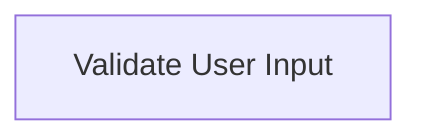

<details>
<summary>Show Code</summary>

```text
flowchart TD
    A[Validate User Input]
```

</details>

---

## 2.2 Rounded Rectangle (Terminal / Start–End)

Written as `A([Label])`. Rounded corners signal lifecycle boundaries — start
states, end states, and entry/exit points.


<details>
<summary>Show Code</summary>

```text
flowchart TD
    A([Application Start])
    B[Initialize Services]
    C([Shutdown])

    A --> B --> C
```

</details>

---

## 2.3 Stadium Shape

Also `A([Label])`, used for softer emphasis than a plain rectangle. Good for
status indicators, milestones, and runtime state markers.


<details>
<summary>Show Code</summary>

```text
flowchart TD
    A([Cache Warmed])
```

</details>

---

## 2.4 Subroutine Shape

Written as `A[[Label]]`. Communicates abstraction and reuse — calling reusable
logic, invoking libraries, or triggering shared workflows.

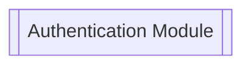

<details>
<summary>Show Code</summary>

```text
flowchart TD
    A[[Authentication Module]]
```

</details>

---

## 2.5 Cylinder (Database)

Written as `DB[(Label)]`. The cylinder is universally recognized as storage —
databases, persistent storage, and data warehouses.

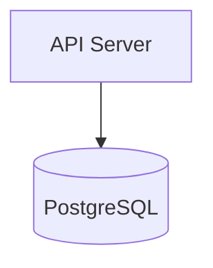

<details>
<summary>Show Code</summary>

```text
flowchart TD
    API[API Server] --> DB[(PostgreSQL)]
```

</details>

---

## 2.6 Circle

Written as `A((Label))`. The circular shape implies a lightweight asynchronous
event — events, triggers, and signal points.

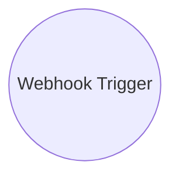

<details>
<summary>Show Code</summary>

```text
flowchart TD
    A((Webhook Trigger))
```

</details>

---

## 2.7 Diamond (Decision)

Written as `A{Label}`. The standard UML decision symbol for branching logic,
conditional decisions, and boolean evaluation.

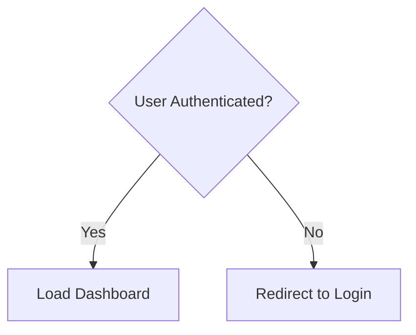

<details>
<summary>Show Code</summary>

```text
flowchart TD
    A{User Authenticated?}
    B[Load Dashboard]
    C[Redirect to Login]

    A -->|Yes| B
    A -->|No| C
```

</details>

---

# 3. Advanced Flowchart Shapes

---

## 3.1 Hexagon (Preparation)

Written as `A{{Label}}`. Visually distinguishes preparatory steps — setup
phases, initialization, and configuration loading.

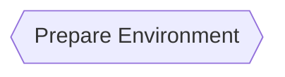

<details>
<summary>Show Code</summary>

```text
flowchart TD
    A{{Prepare Environment}}
```

</details>

---

## 3.2 Parallelogram (Input / Output)

Written as `A[/Label/]`. Clearly communicates interaction with external systems
or users — user input, file uploads, and output generation.

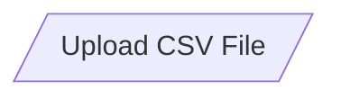

<details>
<summary>Show Code</summary>

```text
flowchart TD
    A[/Upload CSV File/]
```

</details>

---

## 3.3 Inverted Parallelogram

Written as `A[\Label\]`. Creates a directional distinction from standard input
nodes — output-only operations, reporting, and presentation layers.

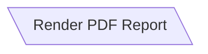

<details>
<summary>Show Code</summary>

```text
flowchart TD
    A[\Render PDF Report\]
```

</details>

---

## 3.4 Trapezoid

Written as `A[/Label\]`. Makes human tasks stand apart from automation — manual
intervention, human workflows, and external review processes.

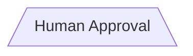

<details>
<summary>Show Code</summary>

```text
flowchart TD
    A[/Human Approval\]
```

</details>

---

# 4. UML Class Diagram Shapes

Mermaid also supports proper UML class diagrams via `classDiagram`.

---

## 4.1 Basic Class

A class represents an entity with attributes and methods. Use it for
object-oriented modeling, domain modeling, and API design.

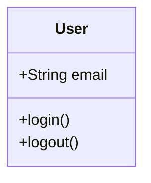

<details>
<summary>Show Code</summary>

```text
classDiagram
    class User {
        +String email
        +login()
        +logout()
    }
```

</details>

---

## 4.2 Inheritance

The `<|--` arrow communicates inheritance — polymorphism, shared behaviors, and
hierarchical models.

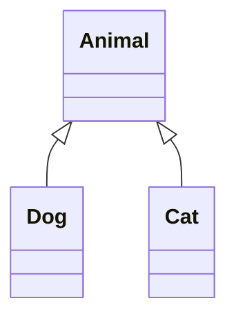

<details>
<summary>Show Code</summary>

```text
classDiagram
    Animal <|-- Dog
    Animal <|-- Cat
```

</details>

---

## 4.3 Composition

The `*--` arrow indicates strong containment, where the child's lifecycle
depends on the parent and ownership is strict.

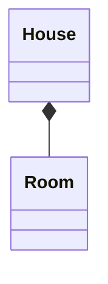

<details>
<summary>Show Code</summary>

```text
classDiagram
    House *-- Room
```

</details>

---

## 4.4 Aggregation

The `o--` arrow implies loose ownership — objects are related but exist
independently.

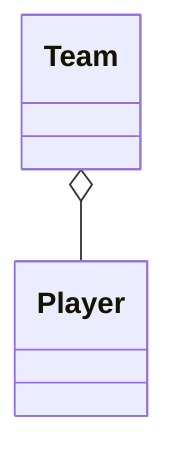

<details>
<summary>Show Code</summary>

```text
classDiagram
    Team o-- Player
```

</details>

---

# 5. Sequence Diagram Participants

---

## 5.1 Actor

`actor` differentiates humans from system components — external users, external
systems, and human interactions.

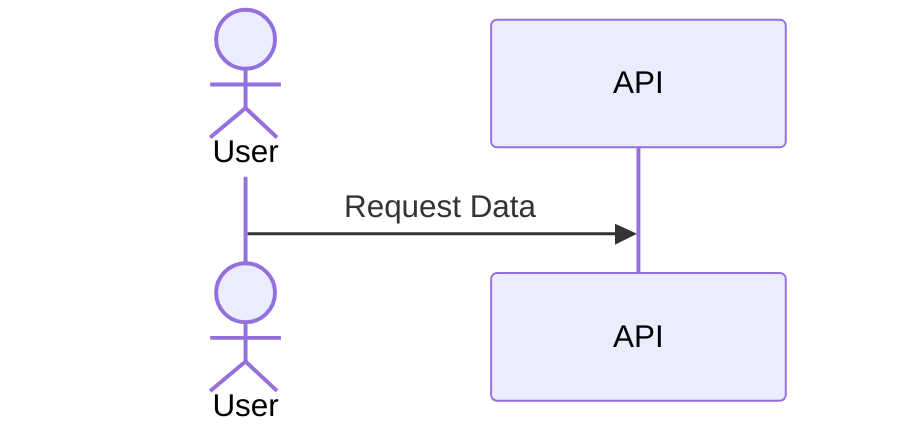

<details>
<summary>Show Code</summary>

```text
sequenceDiagram
    actor User
    participant API

    User->>API: Request Data
```

</details>

---

## 5.2 Participant

`participant` shows communication flow between components — services, APIs, and
internal systems.

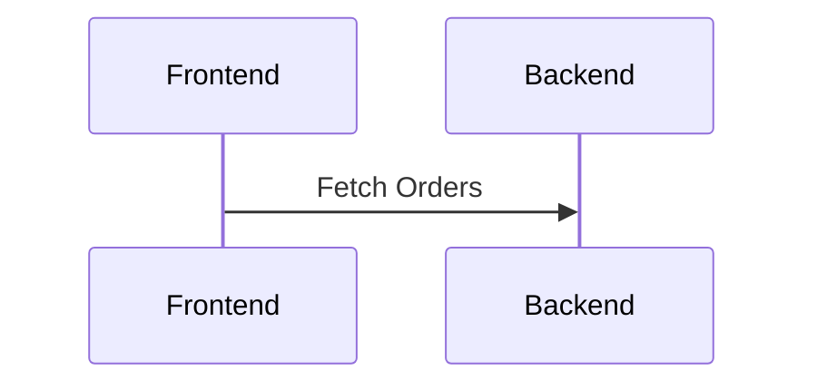

<details>
<summary>Show Code</summary>

```text
sequenceDiagram
    participant Frontend
    participant Backend

    Frontend->>Backend: Fetch Orders
```

</details>

---

# 6. State Diagram Shapes

State diagrams (`stateDiagram-v2`) are perfect for event-driven systems —
lifecycle modeling, workflow engines, and state machines. `[*]` marks the
initial and final states.

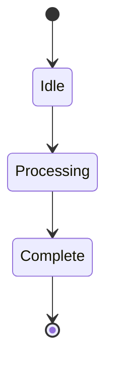

<details>
<summary>Show Code</summary>

```text
stateDiagram-v2
    [*] --> Idle
    Idle --> Processing
    Processing --> Complete
    Complete --> [*]
```

</details>

---

# 7. Entity Relationship Diagrams (ERD)

ERDs (`erDiagram`) communicate relational structure efficiently — database
schema design, data modeling, and backend planning. The crow's-foot notation
encodes cardinality.

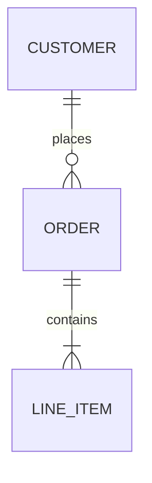

<details>
<summary>Show Code</summary>

```text
erDiagram
    CUSTOMER ||--o{ ORDER : places
    ORDER ||--|{ LINE_ITEM : contains
```

</details>

---

# 8. Gantt Diagram Elements

Gantt charts (`gantt`) are excellent for visual scheduling — project planning,
sprint scheduling, and timelines.

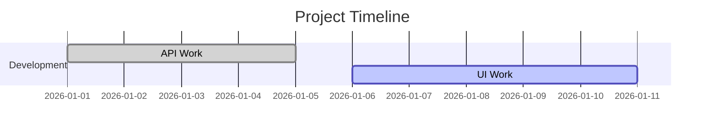

<details>
<summary>Show Code</summary>

```text
gantt
    title Project Timeline
    dateFormat  YYYY-MM-DD

    section Development
    API Work :done, des1, 2026-01-01,2026-01-05
    UI Work  :active, des2, 2026-01-06, 5d
```

</details>

---

# 9. Full Example Architecture Diagram

A single diagram combining many of the shapes above.

```mermaid
flowchart LR

    User((User))

    FE[Frontend App]

    API[[API Gateway]]

    AUTH{{Auth Service}}

    DB[(PostgreSQL)]

    CACHE[(Redis)]

    REPORT[/Generate PDF/]

    User --> FE
    FE --> API
    API --> AUTH
    API --> DB
    API --> CACHE
    API --> REPORT
```

<details>
<summary>Show Code</summary>

```text
flowchart LR

    User((User))

    FE[Frontend App]

    API[[API Gateway]]

    AUTH{{Auth Service}}

    DB[(PostgreSQL)]

    CACHE[(Redis)]

    REPORT[/Generate PDF/]

    User --> FE
    FE --> API
    API --> AUTH
    API --> DB
    API --> CACHE
    API --> REPORT
```

</details>

---

# 10. MermaidJS Documentation

* Official Documentation: https://mermaid.js.org/
* Live Editor: https://mermaid.live/

---

# Conclusion

MermaidJS provides a lightweight yet powerful way to create UML-style diagrams
directly from text. Choosing the right shape improves readability, architecture
communication, team alignment, and documentation quality.

The best diagrams use consistent semantics and minimal visual complexity while
emphasizing workflow clarity.
