# MermaidJS UML Shapes & Diagram Syntax Guide

## Introduction

[MermaidJS](https://mermaid.js.org/) is a text-based diagramming language that allows you to create UML diagrams, flowcharts, sequence diagrams, entity relationships, state diagrams, and more using simple markdown-like syntax.

This document focuses on:

* Common UML and flowchart node shapes
* MermaidJS syntax for each shape
* Visual examples
* When and why to use each shape

---

# 1. Basic Flowchart Shapes

Mermaid flowcharts support many UML-style node shapes.

---

## 1.1 Rectangle (Process)

### Syntax

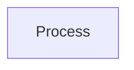

### Example

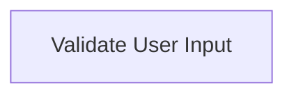

### Use Cases

Use rectangles for:

* Generic processing steps
* Business logic
* Function execution
* Service calls

### Why Use It

This is the default “do something” shape and works well for most workflow operations.

---

## 1.2 Rounded Rectangle (Terminal / Start-End)

### Syntax

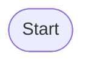

### Example

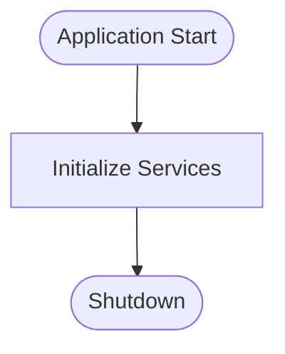

### Use Cases

Use for:

* Start states
* End states
* Entry/exit points

### Why Use It

Rounded corners visually indicate lifecycle boundaries.

---

## 1.3 Stadium Shape

### Syntax

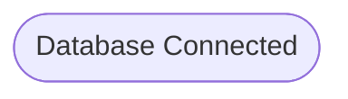

### Example

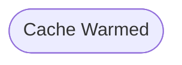

### Use Cases

Useful for:

* Status indicators
* Milestones
* Runtime state markers

### Why Use It

Provides softer visual emphasis than standard rectangles.

---

## 1.4 Subroutine Shape

### Syntax

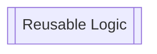

### Example

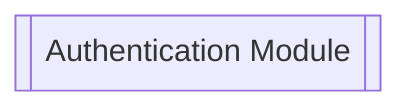

### Use Cases

Use when:

* Calling reusable logic
* Invoking libraries
* Triggering shared workflows

### Why Use It

Communicates abstraction and reuse.

---

## 1.5 Cylinder (Database)

### Syntax

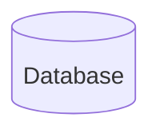

### Example

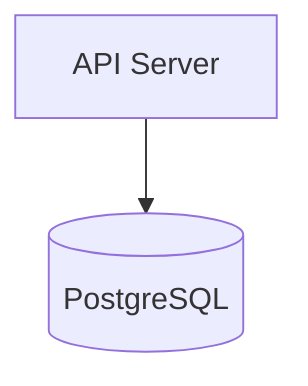

### Use Cases

Use for:

* Databases
* Persistent storage
* Data warehouses

### Why Use It

The cylinder is universally recognized as storage infrastructure.

---

## 1.6 Circle

### Syntax

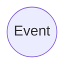

### Example

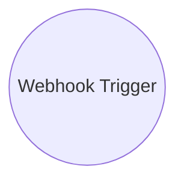

### Use Cases

Ideal for:

* Events
* Triggers
* Signal points

### Why Use It

The circular shape implies a lightweight asynchronous event.

---

## 1.7 Diamond (Decision)

### Syntax

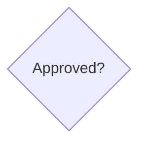

### Example

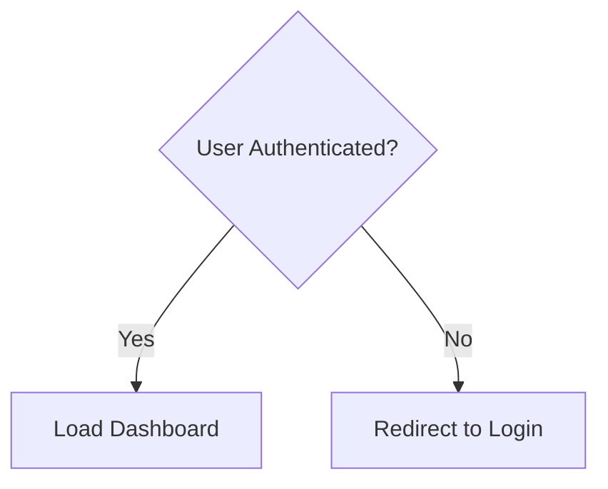

### Use Cases

Use for:

* Branching logic
* Conditional decisions
* Boolean evaluation

### Why Use It

The diamond is the standard UML decision symbol.

---

# 2. Advanced Flowchart Shapes

---

## 2.1 Hexagon (Preparation)

### Syntax

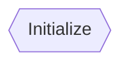

### Example

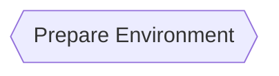

### Use Cases

Good for:

* Setup phases
* Initialization
* Configuration loading

### Why Use It

Visually distinguishes preparatory steps from execution steps.

---

## 2.2 Parallelogram (Input / Output)

### Syntax

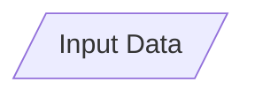

### Example

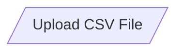

### Use Cases

Use for:

* User input
* File uploads
* Output generation

### Why Use It

Clearly communicates interaction with external systems or users.

---

## 2.3 Inverted Parallelogram

### Syntax

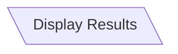

### Example

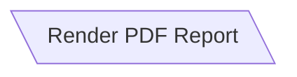

### Use Cases

Useful for:

* Output-only operations
* Reporting
* Presentation layers

### Why Use It

Creates directional visual distinction from standard input nodes.

---

## 2.4 Trapezoid

### Syntax

```mermaid
flowchart TD
    A[/Manual Task\]
```

### Example

```mermaid
flowchart TD
    A[/Human Approval\]
```

### Use Cases

Use for:

* Manual intervention
* Human workflows
* External review processes

### Why Use It

Makes human tasks visually stand apart from automation.

---

# 3. UML Class Diagram Shapes

Mermaid also supports proper UML class diagrams.

---

## 3.1 Basic Class

### Syntax

```mermaid
classDiagram
    class User
```

### Example

```mermaid
classDiagram
    class User {
        +String email
        +login()
        +logout()
    }
```

### Use Cases

Use for:

* Object-oriented modeling
* Domain modeling
* API design

### Why Use It

Represents entities with attributes and methods.

---

## 3.2 Inheritance

### Example

```mermaid
classDiagram
    Animal <|-- Dog
    Animal <|-- Cat
```

### Use Cases

Use for:

* Polymorphism
* Shared behaviors
* Hierarchical models

### Why Use It

Clearly communicates object inheritance.

---

## 3.3 Composition

### Example

```mermaid
classDiagram
    House *-- Room
```

### Use Cases

Use when:

* Child lifecycle depends on parent
* Ownership is strict

### Why Use It

Composition indicates strong containment.

---

## 3.4 Aggregation

### Example

```mermaid
classDiagram
    Team o-- Player
```

### Use Cases

Use when:

* Objects are related
* But independently exist

### Why Use It

Aggregation implies loose ownership.

---

# 4. Sequence Diagram Participants

---

## 4.1 Actor

### Example

```mermaid
sequenceDiagram
    actor User
    participant API

    User->>API: Request Data
```

### Use Cases

Use for:

* External users
* External systems
* Human interactions

### Why Use It

Differentiates humans from system components.

---

## 4.2 Participant

### Example

```mermaid
sequenceDiagram
    participant Frontend
    participant Backend

    Frontend->>Backend: Fetch Orders
```

### Use Cases

Use for:

* Services
* APIs
* Internal systems

### Why Use It

Shows communication flow between components.

---

# 5. State Diagram Shapes

---

## 5.1 State

### Example

```mermaid
stateDiagram-v2
    [*] --> Idle
    Idle --> Processing
    Processing --> Complete
    Complete --> [*]
```

### Use Cases

Use for:

* Lifecycle modeling
* Workflow engines
* State machines

### Why Use It

Perfect for event-driven systems.

---

# 6. Entity Relationship Diagrams (ERD)

---

## Example

```mermaid
erDiagram
    CUSTOMER ||--o{ ORDER : places
    ORDER ||--|{ LINE_ITEM : contains
```

### Use Cases

Use for:

* Database schema design
* Data modeling
* Backend planning

### Why Use It

ERDs communicate relational structure efficiently.

---

# 7. Gantt Diagram Elements

---

## Example

```mermaid
gantt
    title Project Timeline
    dateFormat  YYYY-MM-DD

    section Development
    API Work :done, des1, 2026-01-01,2026-01-05
    UI Work  :active, des2, 2026-01-06, 5d
```

### Use Cases

Use for:

* Project planning
* Sprint scheduling
* Timelines

### Why Use It

Excellent for visual scheduling.

---

# 8. Best Practices

## Use Consistent Shape Semantics

Avoid using random shapes interchangeably.

Recommended conventions:

| Shape             | Meaning      |
| ----------------- | ------------ |
| Rectangle         | Process      |
| Diamond           | Decision     |
| Cylinder          | Database     |
| Circle            | Event        |
| Rounded Rectangle | Start/End    |
| Parallelogram     | Input/Output |

---

## Keep Diagrams Small

Large Mermaid diagrams become difficult to maintain.

Recommended:

* Split into modules
* Use subgraphs
* Create layered diagrams

---

## Use Direction Intentionally

```mermaid
flowchart LR
```

vs

```mermaid
flowchart TD
```

| Direction | Best For                   |
| --------- | -------------------------- |
| TD        | Workflows                  |
| LR        | Architecture diagrams      |
| BT        | Dependency inversion       |
| RL        | Reverse-flow visualization |

---

# 9. Full Example Architecture Diagram

```mermaid
flowchart LR

    User((User))

    FE[Frontend App]

    API[[API Gateway]]

    AUTH{{Auth Service}}

    DB[(PostgreSQL)]

    CACHE[(Redis)]

    REPORT[/Generate PDF/]

    User --> FE
    FE --> API
    API --> AUTH
    API --> DB
    API --> CACHE
    API --> REPORT
```

---

# 10. MermaidJS Documentation

Official Documentation:

* https://mermaid.js.org/

Live Editor:

* https://mermaid.live/

---

# Conclusion

MermaidJS provides a lightweight yet powerful way to create UML-style diagrams directly from text.

Choosing the right shape improves:

* Readability
* Architecture communication
* Team alignment
* Documentation quality

The best diagrams use consistent semantics and minimal visual complexity while emphasizing workflow clarity.
