# PlantUML Shapes & UML Diagram Reference Guide

## Introduction

[PlantUML](https://plantuml.com/) is a text-based diagramming language for generating UML diagrams, architecture diagrams, sequence flows, ERDs, state machines, and more.

Compared to MermaidJS, PlantUML offers:

* Richer UML support
* Better enterprise architecture modeling
* More advanced styling
* More diagram types
* Better skin/theme customization

This guide covers:

* Common UML shapes
* Flowchart elements
* Component modeling
* Class diagrams
* Sequence diagrams
* State diagrams
* Practical use cases

---

# 1. Basic Activity Diagram Shapes

PlantUML activity diagrams are often used similarly to flowcharts.

---

## 1.1 Start and End Nodes

### Syntax

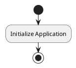

### Example

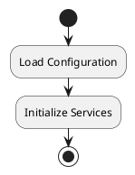

### Use Cases

Use for:

* Entry points
* Workflow boundaries
* Lifecycle visualization

### Why Use It

Clearly defines process beginning and termination.

---

## 1.2 Action / Process Block

### Syntax

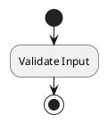

### Example

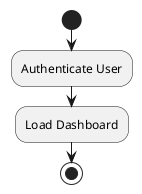

### Use Cases

Use for:

* Business logic
* Operations
* Service execution
* Generic workflow steps

### Why Use It

Represents standard processing tasks.

---

## 1.3 Decision Node

### Syntax

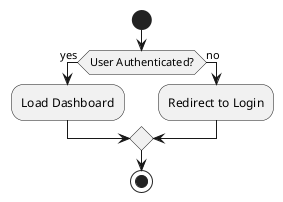

### Example

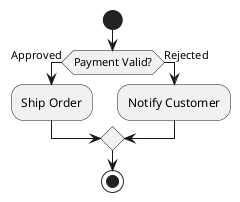

### Use Cases

Use for:

* Conditional branching
* Validation logic
* Approval workflows

### Why Use It

Decision nodes visually separate logical branches.

---

## 1.4 Fork / Parallel Processing

### Syntax

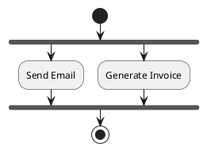

### Example

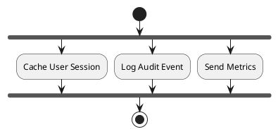

### Use Cases

Use for:

* Concurrent tasks
* Asynchronous operations
* Event-driven systems

### Why Use It

Clearly communicates parallel execution.

---

# 2. UML Class Diagram Shapes

PlantUML excels at class modeling.

---

## 2.1 Basic Class

### Syntax

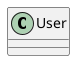

### Example

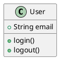

### Use Cases

Use for:

* Domain models
* Object-oriented design
* API contracts

### Why Use It

Defines attributes and behaviors in one place.

---

## 2.2 Abstract Class

### Syntax

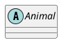

### Example

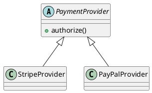

### Use Cases

Use for:

* Shared interfaces
* Base implementations
* Polymorphic systems

### Why Use It

Clarifies inheritance and abstraction.

---

## 2.3 Interface

### Syntax

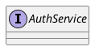

### Example

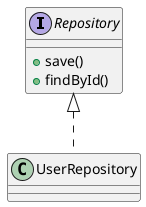

### Use Cases

Use for:

* Dependency inversion
* Contracts
* Plugin architectures

### Why Use It

Separates implementation from behavior.

---

## 2.4 Enumeration

### Syntax

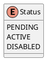

### Use Cases

Use for:

* Fixed state definitions
* Constants
* Workflow stages

### Why Use It

Documents restricted value sets.

---

# 3. Relationships

---

## 3.1 Inheritance

### Example

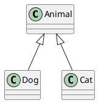

### Meaning

Represents “is-a” relationships.

### Use Cases

Use for:

* Shared behavior
* Polymorphism
* Taxonomies

---

## 3.2 Composition

### Example

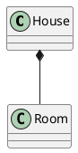

### Meaning

Strong ownership.

### Use Cases

Use when:

* Child lifecycle depends on parent
* Objects cannot exist independently

---

## 3.3 Aggregation

### Example

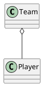

### Meaning

Weak ownership.

### Use Cases

Use when:

* Related objects exist independently

---

## 3.4 Dependency

### Example

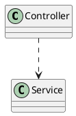

### Meaning

Temporary usage relationship.

### Use Cases

Use for:

* Service calls
* Method usage
* Loose coupling

---

# 4. Sequence Diagram Elements

PlantUML sequence diagrams are among its strongest features.

---

## 4.1 Actors

### Example

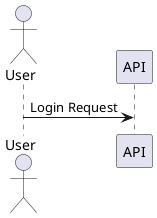

### Use Cases

Use for:

* Humans
* External systems
* Third-party integrations

---

## 4.2 Participants

### Example

```plantuml
@startuml

participant Frontend
participant Backend
database PostgreSQL

Frontend -> Backend : Fetch Orders
Backend -> PostgreSQL : SELECT *

@enduml
```

### Use Cases

Use for:

* Services
* APIs
* Databases
* Internal systems

---

## 4.3 Activation Bars

### Example

```plantuml
@startuml

participant API

API -> API : Process Request
activate API

API --> API : Response
deactivate API

@enduml
```

### Use Cases

Use for:

* Long-running operations
* Async handling
* Internal processing visibility

---

# 5. Component Diagram Shapes

---

## 5.1 Components

### Example

```plantuml
@startuml

component "Frontend App" as FE
component "API Gateway" as API
database PostgreSQL

FE --> API
API --> PostgreSQL

@enduml
```

### Use Cases

Use for:

* System architecture
* Service mapping
* Infrastructure diagrams

### Why Use It

Excellent for high-level architecture visualization.

---

## 5.2 Nodes (Infrastructure)

### Example

```plantuml
@startuml

node "Kubernetes Cluster" {
  component API
  component Worker
}

database PostgreSQL

API --> PostgreSQL

@enduml
```

### Use Cases

Use for:

* Deployment architecture
* Cloud topology
* Infrastructure layouts

---

# 6. State Diagram Shapes

---

## Example

```plantuml
@startuml

[*] --> Idle
Idle --> Processing
Processing --> Completed
Completed --> [*]

@enduml
```

### Use Cases

Use for:

* Workflow engines
* UI state management
* Event-driven systems

### Why Use It

Clearly communicates state transitions.

---

# 7. Entity Relationship Diagrams

---

## Example

```plantuml
@startuml

entity User {
  *id : UUID
  --
  email : string
}

entity Order {
  *id : UUID
  --
  total : decimal
}

User ||--o{ Order

@enduml
```

### Use Cases

Use for:

* Database schema design
* Backend planning
* Data modeling

---

# 8. Deployment Diagram Shapes

---

## Example

```plantuml
@startuml

node "Web Server" {
  artifact app.war
}

database "PostgreSQL"

artifact app.war --> PostgreSQL

@enduml
```

### Use Cases

Use for:

* Infrastructure documentation
* Runtime topology
* Deployment planning

---

# 9. Common Shape Keywords

| Shape          | Keyword        |
| -------------- | -------------- |
| Actor          | actor          |
| Participant    | participant    |
| Class          | class          |
| Abstract Class | abstract class |
| Interface      | interface      |
| Enum           | enum           |
| Component      | component      |
| Node           | node           |
| Database       | database       |
| Queue          | queue          |
| Artifact       | artifact       |
| Package        | package        |
| Folder         | folder         |
| Cloud          | cloud          |
| Frame          | frame          |

---

# 10. Architecture Example

```plantuml
@startuml

actor User

node "CDN" {
  component Frontend
}

cloud "AWS" {

  node "Kubernetes Cluster" {

    component API
    component Worker

  }

  database PostgreSQL
  queue RabbitMQ
}

User --> Frontend
Frontend --> API
API --> PostgreSQL
API --> RabbitMQ
Worker --> RabbitMQ

@enduml
```

---

# 11. Styling & Themes

PlantUML supports themes and styling.

---

## Example Theme

```plantuml
@startuml
!theme spacelab

component API
database PostgreSQL

API --> PostgreSQL

@enduml
```

---

## Custom Colors

```plantuml
@startuml

skinparam componentStyle rectangle

component API #LightBlue
database PostgreSQL #LightGreen

@enduml
```

### Use Cases

Use styling to:

* Group environments
* Improve readability
* Match branding
* Highlight critical paths

---

# 12. Best Practices

---

## Use Appropriate Diagram Types

| Goal             | Recommended Diagram |
| ---------------- | ------------------- |
| API interactions | Sequence            |
| Domain modeling  | Class               |
| Infrastructure   | Component           |
| Lifecycle        | State               |
| Database schema  | ERD                 |
| Workflow         | Activity            |

---

## Keep Diagrams Focused

Avoid giant “everything” diagrams.

Recommended:

* One responsibility per diagram
* Modular architecture views
* Separate runtime vs deployment concerns

---

## Name Components Clearly

Prefer:

* `AuthService`
* `PaymentGateway`
* `NotificationWorker`

Avoid:

* `Service1`
* `Thing`
* `Manager`

---

# 13. PlantUML vs MermaidJS

| Feature               | MermaidJS | PlantUML  |
| --------------------- | --------- | --------- |
| Simplicity            | Excellent | Good      |
| UML Depth             | Moderate  | Excellent |
| Styling               | Basic     | Advanced  |
| Architecture Modeling | Moderate  | Excellent |
| IDE Integration       | Good      | Excellent |
| Git Rendering         | Excellent | Good      |
| Enterprise Diagrams   | Moderate  | Excellent |

---

# 14. Official Resources

Official Site:

* https://plantuml.com/

Online Editor:

* https://www.plantuml.com/plantuml/

Hitchhiker's Guide:

* https://crashedmind.github.io/PlantUMLHitchhikersGuide/

---

# Conclusion

PlantUML is one of the most powerful text-based UML tools available.

It excels at:

* Enterprise architecture
* Rich UML modeling
* Sequence diagrams
* Infrastructure visualization
* Large-scale software documentation

PlantUML is ideal when you need:

* Precise UML semantics
* Large architecture diagrams
* Advanced customization
* Long-term maintainable technical documentation
