# PlantUML Shapes & UML Diagram Reference Guide

## Introduction

[PlantUML](https://plantuml.com/) is a text-based diagramming language for
generating UML diagrams, architecture diagrams, sequence flows, ERDs, state
machines, and more, all written in a compact, readable syntax wrapped in
`@startuml` / `@enduml` blocks.

Each section below shows the **rendered diagram** first. Click **Show Code** to
reveal the text syntax that produced it, so you can learn the syntax shape by
shape without being overwhelmed by walls of code.

> Every diagram in this guide is generated from a `.puml` file in
> [`./examples`](./examples). The `.svg` images are rendered from those sources
> with `plantuml -tsvg examples/*.puml`, so the source of truth and the picture
> never drift apart.

---

# 1. Cheat Sheet & Best Practices

## Common Shapes

Use shapes consistently — don't swap them interchangeably. Recommended keywords
and their meaning:

| Shape          | Keyword          | Meaning                          |
| -------------- | ---------------- | -------------------------------- |
| Actor          | `actor`          | Human or external system         |
| Participant    | `participant`    | Service / internal system        |
| Class          | `class`          | Object-oriented entity           |
| Abstract Class | `abstract class` | Base / shared implementation     |
| Interface      | `interface`      | Contract / behavior              |
| Enum           | `enum`           | Fixed value set                  |
| Component      | `component`      | Deployable unit / service        |
| Node           | `node`           | Host / runtime container         |
| Database       | `database`       | Persistent storage               |
| Queue          | `queue`          | Message broker                   |
| Artifact       | `artifact`       | Build output / file              |
| Cloud          | `cloud`          | External / managed environment   |
| Entity         | `entity`         | ERD table                        |

---

## Relationship Arrows

PlantUML encodes relationship semantics in the arrow itself:

| Arrow  | Meaning      | Reads As                   |
| ------ | ------------ | -------------------------- |
| `<|--` | Inheritance  | "is-a"                     |
| `*--`  | Composition  | strong ownership           |
| `o--`  | Aggregation  | weak ownership             |
| `..>`  | Dependency   | "uses" / temporary         |
| `-->`  | Association  | directed link / data flow  |
| `<|..` | Realization  | implements an interface    |

---

## Pick the Right Diagram Type

| Goal             | Recommended Diagram |
| ---------------- | ------------------- |
| API interactions | Sequence            |
| Domain modeling  | Class               |
| Infrastructure   | Component           |
| Lifecycle        | State               |
| Database schema  | ERD                 |
| Workflow         | Activity            |

---

## Keep Diagrams Small

Large diagrams become difficult to maintain. Prefer to:

* Keep one responsibility per diagram
* Separate runtime vs deployment concerns
* Name components clearly (`AuthService`, not `Service1`)

---

# 2. Basic Activity Diagram Shapes

PlantUML activity diagrams are used like flowcharts: `start` / `stop` mark
boundaries and each `:Label;` is a step.

---

## 2.1 Start and End Nodes

`start` and `stop` define where a workflow begins and ends. Use them for entry
points, workflow boundaries, and lifecycle visualization.

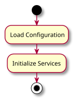

<details>
<summary>Show Code</summary>

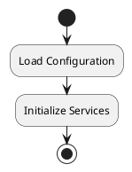

</details>

---

## 2.2 Action / Process Block

A `:Label;` is the standard processing step — business logic, operations,
service execution, and generic workflow steps.

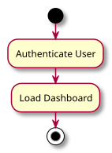

<details>
<summary>Show Code</summary>

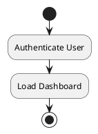

</details>

---

## 2.3 Decision Node

`if (...) then (...) else (...) endif` produces a branch — conditional logic,
validation, and approval workflows.

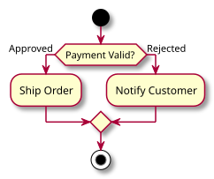

<details>
<summary>Show Code</summary>

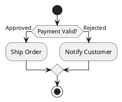

</details>

---

## 2.4 Fork / Parallel Processing

`fork` / `fork again` / `end fork` shows concurrent execution — asynchronous
operations and event-driven systems.

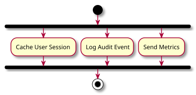

<details>
<summary>Show Code</summary>

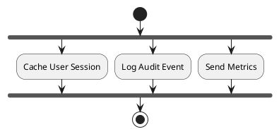

</details>

---

# 3. UML Class Diagram Shapes

PlantUML excels at class modeling.

---

## 3.1 Basic Class

A `class` block defines attributes and methods in one place — domain models,
object-oriented design, and API contracts.

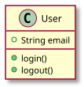

<details>
<summary>Show Code</summary>

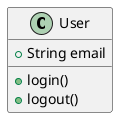

</details>

---

## 3.2 Abstract Class

`abstract class` plus the `<|--` arrow clarifies inheritance and abstraction —
shared base implementations and polymorphic systems.

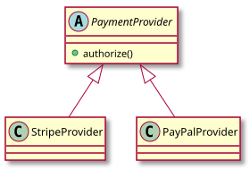

<details>
<summary>Show Code</summary>

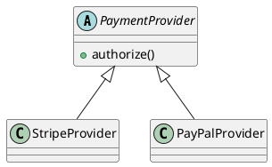

</details>

---

## 3.3 Interface

`interface` plus the `<|..` realization arrow separates behavior from
implementation — dependency inversion, contracts, and plugin architectures.

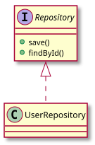

<details>
<summary>Show Code</summary>

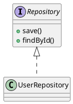

</details>

---

## 3.4 Enumeration

`enum` documents a restricted value set — fixed states, constants, and workflow
stages.

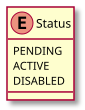

<details>
<summary>Show Code</summary>

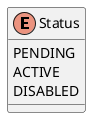

</details>

---

# 4. Relationships

The arrow carries the meaning. These four cover most modeling needs.

---

## 4.1 Inheritance

`<|--` represents an "is-a" relationship — shared behavior, polymorphism, and
taxonomies.

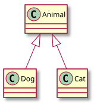

<details>
<summary>Show Code</summary>

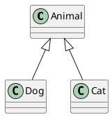

</details>

---

## 4.2 Composition

`*--` is strong ownership — the child cannot exist without the parent and shares
its lifecycle.

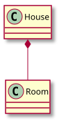

<details>
<summary>Show Code</summary>

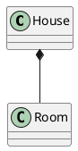

</details>

---

## 4.3 Aggregation

`o--` is weak ownership — related objects that still exist independently.

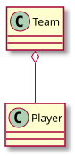

<details>
<summary>Show Code</summary>

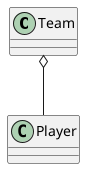

</details>

---

## 4.4 Dependency

`..>` is a temporary usage relationship — service calls, method usage, and loose
coupling.

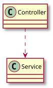

<details>
<summary>Show Code</summary>

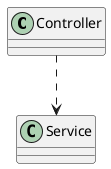

</details>

---

# 5. Sequence Diagram Elements

Sequence diagrams are among PlantUML's strongest features.

---

## 5.1 Actors

`actor` differentiates humans and external systems from internal components.

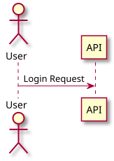

<details>
<summary>Show Code</summary>

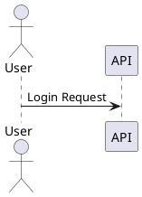

</details>

---

## 5.2 Participants

`participant` and typed lifelines like `database` show communication flow
between services, APIs, and storage.

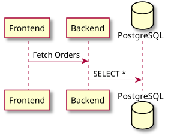

<details>
<summary>Show Code</summary>

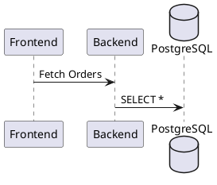

</details>

---

## 5.3 Activation Bars

`activate` / `deactivate` visualize how long a participant is doing work — useful
for long-running or async operations.

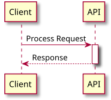

<details>
<summary>Show Code</summary>

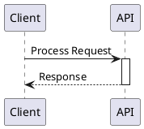

</details>

---

# 6. Component Diagram Shapes

---

## 6.1 Components

`component` and `database` describe system architecture and service maps at a
high level.

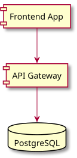

<details>
<summary>Show Code</summary>

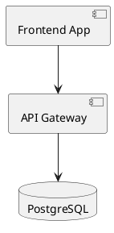

</details>

---

## 6.2 Nodes (Infrastructure)

`node` groups components into deployment units — cloud topology and runtime
layouts.

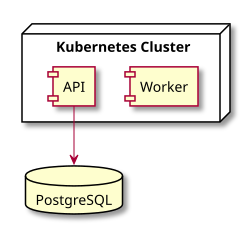

<details>
<summary>Show Code</summary>

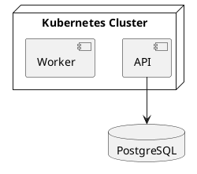

</details>

---

# 7. State Diagram Shapes

State diagrams are perfect for event-driven systems — workflow engines, UI state
management, and lifecycle modeling. `[*]` marks the initial and final states.

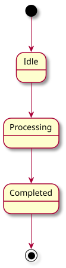

<details>
<summary>Show Code</summary>

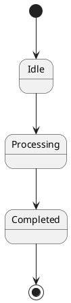

</details>

---

# 8. Entity Relationship Diagrams

`entity` blocks plus crow's-foot arrows (`||--o{`) communicate relational
structure — database schema design, data modeling, and backend planning.

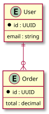

<details>
<summary>Show Code</summary>

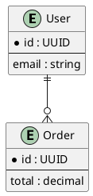

</details>

---

# 9. Deployment Diagram Shapes

`node`, `artifact`, and `database` document runtime topology and deployment
planning.

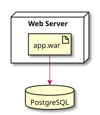

<details>
<summary>Show Code</summary>

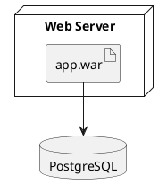

</details>

---

# 10. Full Example Architecture Diagram

A single diagram combining actors, nodes, clouds, components, a database, and a
queue.

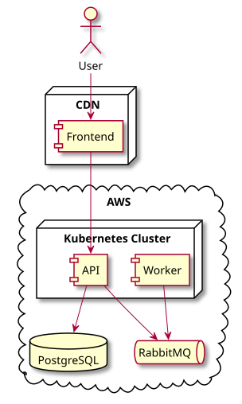

<details>
<summary>Show Code</summary>

```plantuml
@startuml
actor User

node "CDN" {
  component Frontend
}

cloud "AWS" {

  node "Kubernetes Cluster" {

    component API
    component Worker

  }

  database PostgreSQL
  queue RabbitMQ
}

User --> Frontend
Frontend --> API
API --> PostgreSQL
API --> RabbitMQ
Worker --> RabbitMQ
@enduml
```

</details>

---

# 11. Styling & Themes

PlantUML supports global styling through `skinparam` directives and, in newer
releases, the `!theme` directive (e.g. `!theme spacelab`). Use styling to group
environments, improve readability, match branding, and highlight critical paths.

---

## 11.1 Global Skin Styling

`skinparam` changes rendering globally — here a hand-drawn look with a custom
background and rectangular components.

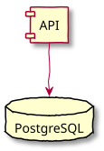

<details>
<summary>Show Code</summary>

```plantuml
@startuml
skinparam handwritten true
skinparam backgroundColor #FDFDFD
skinparam componentStyle rectangle

component API
database PostgreSQL

API --> PostgreSQL
@enduml
```

</details>

---

## 11.2 Custom Colors

Inline `#Color` hints highlight individual elements.

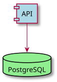

<details>
<summary>Show Code</summary>

```plantuml
@startuml
skinparam componentStyle rectangle

component API #LightBlue
database PostgreSQL #LightGreen

API --> PostgreSQL
@enduml
```

</details>

---

# 12. Rendering the Examples

All sources live in [`./examples`](./examples). Regenerate the SVGs after any
edit:

```bash
plantuml -tsvg examples/*.puml
```

This keeps each `.svg` next to its `.puml` source, so diagrams in this guide
never go stale.

---

# 13. Official Resources

* Official Site: https://plantuml.com/
* Online Editor: https://www.plantuml.com/plantuml/
* Hitchhiker's Guide: https://crashedmind.github.io/PlantUMLHitchhikersGuide/

---

# Conclusion

PlantUML is one of the most powerful text-based UML tools available. It excels at
enterprise architecture, rich UML modeling, sequence diagrams, infrastructure
visualization, and large-scale software documentation.

Reach for PlantUML when you need precise UML semantics, large architecture
diagrams, advanced customization, and long-term maintainable technical
documentation. The best diagrams use consistent semantics and minimal visual
complexity while keeping the source of truth and the rendered image in sync.
